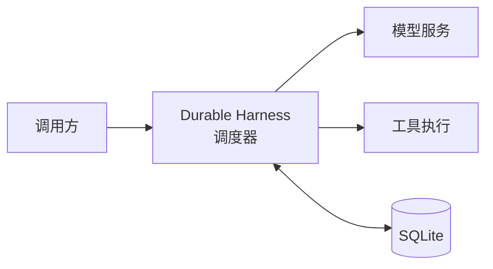
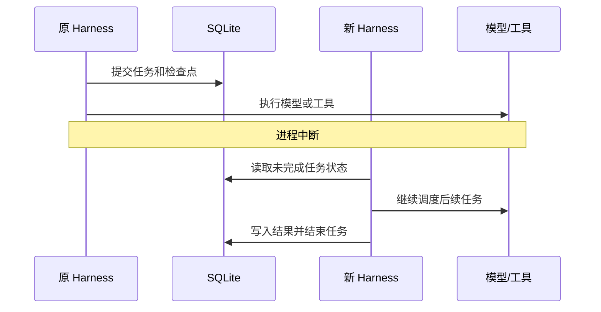
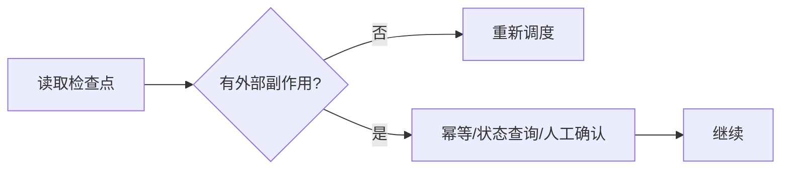

在构建 Agent 系统时，我们通常假设它运行在一个相对平稳的环境中。即便如此，进程意外退出依然是无法回避的痛点。

如果你只是在写一个简单的问答机器人，重启程序可能无关紧要。但当 Agent 开始调用工具——比如操作文件、触发 CI/CD 流程或发送 API 请求时，问题就变得棘手起来：进程在执行动作的半路挂掉，程序重启后如何知道之前走到了哪一步？如果不加处理，重复执行导致的副作用（如重复发邮件或文件写入冲突）往往是致命的。

**Pi Durable** 的核心价值在于将 Agent 的执行逻辑从“瞬时进程”转换为“可持久化的状态机”。通过将 SQLite 作为任务状态的底座，它允许 Agent 在进程重启后，读取序列化的结构化任务、对话上下文和会话配置状态，从中断的任务节点继续执行。

## 一、Pi Durable 是什么：守护任务的运行时

Pi Durable 不是模型本身，也不是单一的数据库，而是一个专门为 Agent 设计的 TypeScript 持久化运行时（Harness）。

它的任务非常明确：接收用户指令、调度模型推理、驱动工具执行，并将整个过程中的结构化状态（任务链、对话事实与配置信息）实时写入 SQLite。这意味着，无论进程何时因异常崩溃，磁盘上的数据库都锁住了关键的执行上下文，而非不可控的易失内存。

其分工逻辑如下：



*图 1：Pi Durable 运行时分工：Harness 调度模型与工具，结构化状态实时写入 SQLite。*

进程崩溃后，重启的 Harness 并非试图找回旧的内存对象，而是通过读取 SQLite 中的状态，重新触发 scheduler 进行调度，让未完成的任务自然地“接续”运行。

## 二、场景抉择：为什么要费心实现持久化？

如果你的 Agent 仅涉及短文本对话，普通 Loop 逻辑即足矣。Pi Durable 的复杂度在于引入了任务模型、数据库事务和恢复策略，因此它更适合以下高可靠性场景：

- **长链路执行**：涉及多轮模型决策与多次工具调用的长复杂任务。
- **异步依赖**：任务需要等待人工审核、长耗时任务或外部系统响应。
- **异常频发环境**：对进程重启后的连续性有明确要求，任务中断带来的代价极高。

简言之，只有当任务“失败重启”的代价大于引入持久化架构的成本时，Pi Durable 才是你的最优选。

## 三、机制导读：任务是如何被“切片”存储的

Pi Durable 将一次复杂的任务拆解为可追踪的任务单元。本文使用的 demo 项目已经放在 GitHub：

[huruizhi/pi-durable-demo](https://github.com/huruizhi/pi-durable-demo)

你可以直接查看源码、SQLite 数据和恢复实验脚本。下面通过 demo 拆解其核心逻辑：

### 1. 任务的接入

初始化 Harness 时，我们通过 `createDurableHarness()` 获取调度核心。任务不再是由孤立的 `await` 调用链串联，而是被提交到一个具备状态记忆的运行环境中。

### 2. 工具调用的任务化

在 Durable 体系中，工具调用不再是函数调用的“黑盒”，而是被明确注册为 `pi.tool` 任务。模型一旦决定调用工具，Harness 就会将工具输入、父子任务关系和执行结果持久化至 SQLite。这确保了即便工具在执行中途进程退出，系统也掌握了“这一步已发生”的确凿证据。

### 3. 提交与接管

```js
const submission = await root.submit({ type: "input", content: prompt }, CONTEXT);
```

`root.submit()` 会在数据库中创建一个 `submission`。后续的模型思考、工具调用、工具反馈，都作为这一 `submission` 的子项被有序记录。

当发生中断并重启时，恢复流程并非重试，而是“接管”：

```js
const harness = await openSameStorage();
await harness.resume(); // 唤醒调度器，接管尚未终结的 submission
```

它利用 SQLite 中的状态，驱动调度器重新识别并继续调度那些尚未完成的任务，从而实现逻辑上的接续。

## 四、原理拆解：Commit、Checkpoint 与 Resume

Pi Durable 的恢复机制核心在于如何准确地划定任务边界。

### 四类记录的协作

| 记录类型 | 职能描述 |
| :--- | :--- |
| **submission** | 任务的全生命周期快照。 |
| **task** | 具体的执行阶段（Generation/Tool Call）。 |
| **entry** | 对话上下文与执行记录。 |
| **document** | 会话环境配置。 |

真正的恢复调度，由 `submission` 和 `task` 协同驱动。

### 恢复的主线逻辑



*图 2：恢复主线：原进程在提交检查点后中断，新 Harness 读取 SQLite 状态并继续调度。*

**Checkpoint** 的本质是 SQLite 中的语义记录。Pi Durable 采用“先提交状态，再触发动作”的策略，确保每次动作发生前都有记录。进程即便崩溃，数据库中也保留了最后确认的语义状态，从而避免了“做了事却没记录”的尴尬。

### 外部边界处理

对于不可重放的外部操作，需配合业务幂等协议：



*图 3：外部边界处理：无副作用的动作可直接重新调度，外部副作用需幂等协议确认。*

框架内部可以保存“准备调用工具”和“工具结果已写入”的状态，但 SQLite 事务不能直接覆盖远端 HTTP 服务、支付网关、邮件系统或宿主机上的 shell 进程。跨系统可靠恢复必须由工具和业务系统提供幂等键、状态查询或补偿协议。

## 五、限制与风险：认清边界

Pi Durable 的能力边界非常清晰，使用前请务必确认：

1. **非内存快照**：它恢复的是结构化任务状态（任务链、上下文、配置），而非原进程的内存、Promise 或调用栈。
2. **Exactly-Once 的缺失**：它不提供跨系统（如外部 API 或 shell）的 Exactly-Once 语义；文件操作、邮件及支付仍需业务层实现幂等协议。
3. **幂等性未完全验证**：当前 `requestId` 的端到端幂等性尚未通过完整验证，不能将其作为唯一可靠的防重依据。
4. **实验局限性**：目前的 `durable_pause` 仅证明了受控任务的恢复，不代表它能自动处理所有并发生产环境下的失败分支。
5. **非生产调度器**：Demo 代码仅用于演示机制，非生产环境下完整的调度实现。
6. **版本依赖**：本文基于 Pi Durable v1.4.0，任务类型与恢复 API 请以实际版本源码为准。

Pi Durable 解决了“任务流的状态保存”问题，它为重启后的 Agent 提供了明确的恢复入口，但不会自动决定外部动作的幂等性。使用时，请将“框架恢复”与“业务幂等”视为独立的两个层面进行设计。
