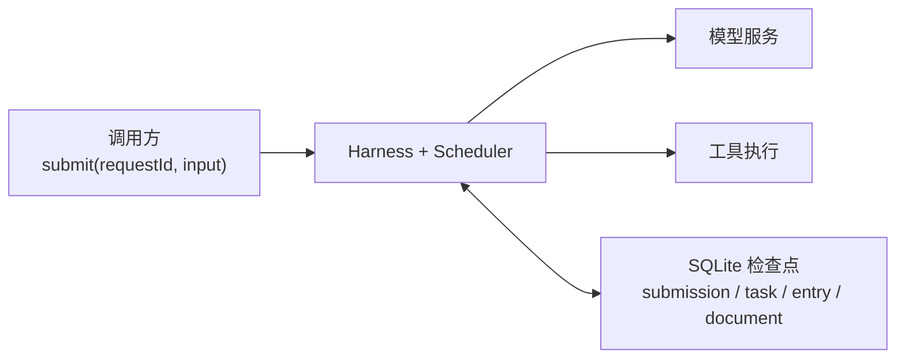
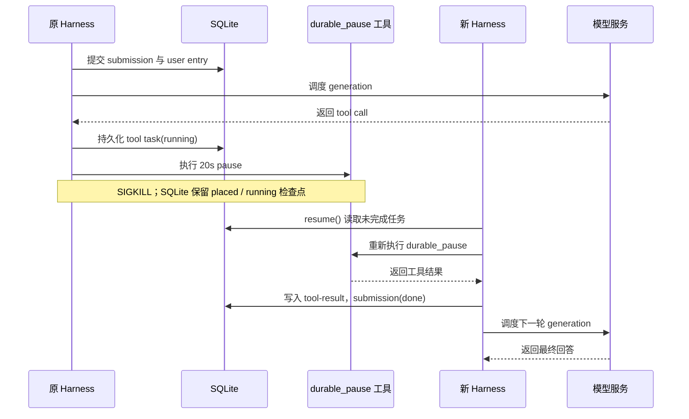
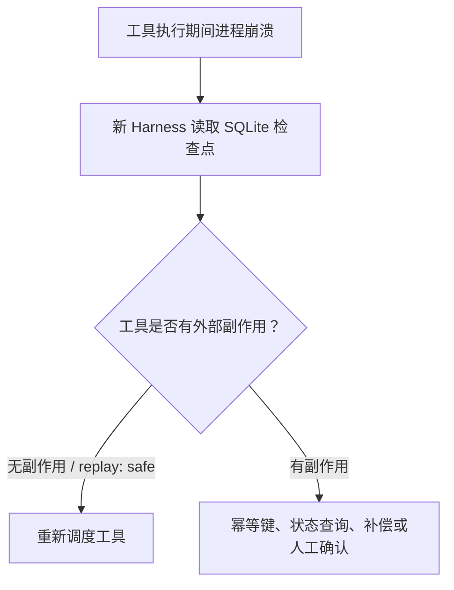

Agent 进程如果意外被杀，最直接的做法往往是把进程重新拉起来，再把原来的用户输入原封不动地发一遍。这种处理方式在演示环境下通常看不出破绽：模型大概率会再次输出类似的文本，整个程序最终也能返回成功。

但在实际应用中，只要任务涉及工具调用，简单的重新运行就会暴露出严重的缺陷。新启动的程序单凭最初那段用户输入，根本无从判断历史状态：工具是完全没有开始执行，还是已经运行结束却没来得及把结果写回？发往远端服务的请求到底是没有发出，还是已经在服务端执行成功，只是本地在等待响应时断掉了？如果在这种不确定的状态下直接重跑，不仅可能白白丢掉已经算完的中间成果，还很有可能把原本只该执行一次的外部动作重复做上一遍。

Pi Durable 所尝试解决的，正是这其中的前一个问题：把 Agent 的执行过程拆解成可以显式提交、随时查询并且支持重新调度的持久化状态。它本身无法替各类异构的外部系统提供天然的 exactly-once 语义。想要看清这层工程边界，就不能仅停留在“底层用了 SQLite”这样的浅层印象上，而要看清楚一次输入在内部究竟如何演变为 submission、task 与 entry，以及进程重启之后，新的 Harness 凭什么能够从中断的地方接续调度。

## 先从故障现场看：丢失的不是一段文本

在常规的 Agent 运行循环里，整个执行链路通常十分直白：读取用户输入、请求大模型、按需执行工具，再将工具执行结果交给模型进行后续总结。在常见的单进程实现中，任务当前执行到了哪一步、等待异步返回的 Promise 以及各类局部变量，往往都直接存放在 Node.js 进程的内存空间里。

如果进程是在模型刚开始推理前退出，重新拉起进程并重跑一遍，顶多只是多消耗一点算力再次生成；但如果进程是在工具已经产生外部影响之后被强行终止，直接重跑就可能引发严重后果：已经写了一半的文件可能被二次覆写，已经触发的 shell 命令可能被重复执行，发往外部接口的请求也可能产生多次调用。更棘手的是，进程崩溃本身并不会留下额外的执行线索，新拉起的进程根本无法仅凭内存残存的信息弄清楚上一次外部动作究竟发生到了哪一步。

因此，一套健壮的恢复机制必须清晰回答两个处于不同层面的问题：

1. **框架内部到底已经持久化提交了什么状态？**
2. **外部真实系统究竟已经产生了哪些实际影响？**

Pi Durable 的设计能够直接回答第一个问题；至于第二个问题，则必须留给具体的业务工具和外部系统自身来界定。如果把这两者混为一谈，就很容易把“框架内部能够恢复中断的任务状态”，误解甚至夸大为“所有任务都可以直接安全重跑”。

## 四种记录各自负责什么

在 Pi Durable 的持久化数据模型中，`submission`、`task`、`entry` 和 `document` 并不是同一个概念在不同场景下的别名，而是分别承载着不同维度的系统状态。

| 记录 | 负责的问题 | 在恢复中的作用 |
| --- | --- | --- |
| `submission` | 这次用户输入是否已被接收、仍在执行，还是已经结束 | 记录一次用户任务的宏观生命周期，状态可为 `queued`、`placed`、`done` 等 |
| `task` | 当前执行阶段是什么、由谁拥有、结果落在哪里 | 保存 `pi.generation`、`pi.tool` 等细分阶段的检查点，驱动后续的任务调度 |
| `entry` | 对话历史中已经正式沉淀了哪些消息、工具调用和工具结果 | 为后续的模型请求提供完整的上下文记忆，也让恢复后的会话能还原发生过的事实 |
| `document` | 会话或 Agent 当前的有类型 JSON 状态是什么 | 保存 `pi.agent`、`pi.live`、`pi.inbox` 等运行配置与应用状态；它不是任务调度器本身 |

在整个体系中，`SQLite` 是这些结构化记录落盘存储的统一介质。`Harness` 负责在启动阶段打开数据库连接、加载当前进程所支持的任务与工具契约，并重新唤醒内置的任务调度器（scheduler）。而外接的模型服务只负责根据提示词提供推理与工具选择能力，它既无法代替 Harness 记录调度进度，更不能保存任务的执行位点。

这也正是为什么“恢复原来的进程”并不是一种准确的说法。崩溃掉的 Node.js 进程内存和调用栈，绝不可能从 SQLite 数据库里自动复活；实际发生的过程是：新创建的 Harness 进程从数据库中重新加载上一次已经持久化提交的记录，再由调度器依据这些清晰的状态数据，决定下一步应该调度哪个任务继续往下走。



*图 1：调用方把任务交给 Harness，模型和工具由调度器驱动，恢复所需状态统一落在 SQLite。*

## 一次请求怎样走到最终回答

在验证 demo 的源码中，客户端通过调用 `root.submit()` 提交任务，并为每一次请求传入唯一的 `requestId`。把一次成功的完整执行过程按时间先后顺序展开，可以看到这样一条流转链条：

```text
submit({ type: "input", content, requestId })
  → submission 持久化，进入 queued / placed
  → pi.generation task 调用模型
  → 模型返回 tool call，写入 assistant entry
  → pi.tool task 执行工具
  → 写入 pi.tool-result entry
  → 下一次 pi.generation task 读取上下文并生成最终文本
  → 写入 final assistant entry
  → submission.status = done
```

调用方在提交之后执行的 `submission.wait()`，其本质仅仅是在当前进程中异步等待该 submission 达到终态（例如变为 `done` 或 `failed`），这本身并不构成任务恢复的逻辑主体。真正促使任务在进程崩溃后仍能继续往下走的，是新启动的进程重新创建 Harness、连接同一份 SQLite 数据库，并重新激活底层的调度循环。

在这套调度模型中，有三个对象边界极其容易被混淆：

第一，`submission` 表达的是“用户向系统交付的这一次完整任务请求”。它的生命周期起点是收到请求，终点是产出最终结论；它可以索引到最初的输入 entry 和最终产出的回答 entry，但它并不直接记录中间细粒度的调度执行步骤。

第二，`task` 表达的是“系统为了推进任务，当前正在执行的某一具体调度阶段”。向模型发起生成请求和具体调用某个工具，会被分别抽象为两个独立的 Durable task；其中执行工具的子任务（`pi.tool`）可以通过 `owner` 字段挂载到触发它的父生成任务（`pi.generation`）之下。数据库里的 `tasks.record` 字段会详尽记录任务类别 `kind`、入参 `input`、归属关系 `owner`、当前执行阶段 `state.status` 以及最终结算状态 `state.outcome`；在工具执行完毕之后，还会通过 `result.entryId` 建立与所产出条目的引用。

第三，`entry` 表达的是“已经确认落盘、正式写入对话上下文的交互事实”。当模型决定发起工具调用时，会生成一条带有工具调用意图的 `pi.assistant` entry；当工具完成调用后，系统会追加一条记录了执行返回内容的 `pi.tool-result` entry；直到模型最终完成汇总输出，再沉淀最后一段 assistant entry。这些 entry 为大模型提供了理解会话历史所需的全部上下文，但 entry 本身只是按序追加的数据事实，它并不直接指挥调度器下一步该调度哪个 task。

在这种设计下，每个可恢复边界都遵循着一个关键的先后顺序：必须先把当前阶段的状态提交并持久化到存储中，然后再由调度器把下一步操作交接给执行环境。这样一来，无论进程在后续哪一个时间点意外退出，重新拉起的进程都至少能清晰读取到最后一次成功落盘的确定状态；而那些尚未完成持久化提交的内存变化，绝不会被误认作已经生效的系统事实。

## Checkpoint 不是调用栈快照

保存在 SQLite 数据库中的 task 记录，其本质是一套语义清晰的状态机记录，而不是对 Node.js 进程内存或 JavaScript 调用栈所做的二进制快照。根据 demo 数据库中的实际数据，可以看到这三类核心状态之间最小的流转关系：

```text
submission: queued / placed → done | failed | aborted

task:       waiting / running → terminal(completed | failed | aborted)

entry:      user → assistant(toolCall) → tool-result → assistant(final)
```

以一个工具调用任务为例，`pi.tool` task 的数据记录中完整保留了触发该调用的模型输出 `assistant` entry 编号、对应的父任务 `owner` 标识，并在执行结束时记录下产出条目的 `state.outcome.result.entryId`。当新进程介入接手恢复时，Harness 完全不需要去揣摩模型上一轮到底想要调用哪个工具、传入了什么参数，因为这些调用意图及其所处的执行状态，早在工具真正开始执行之前就已经作为检查点被稳妥地记录下来了。

相比之下，`document` 承担的是另一套完全不同的状态维护职责。在当前 demo 的实现中，`pi.agent` 文档集中保存着模型配置、已启用的工具扩展列表以及当前的工作目录；而 `pi.live` 与 `pi.inbox` 则负责维系运行时的事件收件箱与在线状态。这些具备确定数据模式的 JSON 文档，主要作用是协助新进程快速重建出与原会话一致的环境配置与运行上下文，但它们本身并不能替代 scheduler 判断某个具体的工具任务是否已经执行完成。如果把数据库中的所有数据表都不加区分地笼统称为“检查点”，反而会掩盖状态恢复背后的因果关系：在整个恢复机制中，真正驱动系统向前调度的始终是 submission 与 task 的状态迁移，entry 负责拼装出连续的上下文事实，而 document 则负责撑起会话底层的配置与运行环境。

## 受控中断实验：同一个 submission 如何继续

在现有的项目验证材料中，包含了一次在独立 SQLite 数据库上完成的受控恢复实验。实验固定使用 `recovery-experiment-001` 作为全局唯一的 `request_id`：先由子进程启动 Harness 并提交任务请求；本地模型解析意图后，决定调用一个专门用于测试的实验工具 `durable_pause`，并传入 20 秒的时长参数；父进程在捕获到工具打印出的启动标记后，立即向子进程发送 `SIGKILL` 信号，制造精准的强制退出。

在子进程被杀之后，直接查询该数据库获得的中断快照显示：

- `pi.generation` task 处于 `waiting` 状态，正在等待工具调用的返回；
- `pi.tool` task 处于 `running` 状态，表明工具已经被调度启动，但结果尚未提交；
- 整个 submission 仍处于 `placed` 状态，并未走到终态；
- 对话 entries 仅记录到 `pi.assistant(stopReason=toolUse)`，尚未生成对应的 tool-result。

这一组快照非常关键。它直接证实了系统在强行中断时，持久化保留的是“工具调用已经被调度安排、但执行结果尚未落盘回填”的中间断点，而不是一条已经执行完毕的终结状态。

随后，实验启动了一个全新的进程来创建 Harness，重新连接同一个 SQLite 数据库。新进程检测到了一个待处理的 pending submission，打印出 `RESUME_PENDING:1` 标记，接着执行 `harness.resume()` 唤醒内置调度器。在恢复进程中，`durable_pause` 工具被重新调度并顺利执行完毕，系统随后将执行结果写入新的 tool-result entry，接着触发第二轮 generation 任务调用模型，最终产出了包含最终答案的 assistant 文本回答。

从恢复后的数据库快照中可以看到完整的执行闭环：

- `pi.generation` task 共有 2 个，状态均已流转为终态 `terminal/completed`；
- `pi.tool` task 共有 1 个，状态流转为终态 `terminal/completed`；
- submission 状态流转为 `done`；
- 整个任务的 `request_id` 依然完整保持为 `recovery-experiment-001`；
- 最终的文本回答精准对应到了编号为 15 的 answer entry；
- 对话 entries 中按正确的时序补齐了 `pi.tool-result(toolName=durable_pause)` 以及最终结束生成的 `pi.assistant(stopReason=stop)`。



*图 2：旧进程中断后，新 Harness 从 SQLite 检查点重新调度工具并完成同一 submission。*

这组前后对照严密的快照，支撑起了一个经过严格收窄的技术结论：新的 Harness 确实能够从同一份 SQLite 数据库中识别出原本处于 `waiting`、`running` 和 `placed` 的中间状态，并由调度器重新接管未完成的 submission，直到整个流程闭环。整个恢复过程所依赖的基石，始终是已经落盘提交的框架状态机记录，而绝非原进程残留的调用栈或内存变量。

但同样必须强调这次实验的受控边界：`durable_pause` 是一个专门为了稳定制造中断时间窗口而设计的无害工具，父进程也是在特定控制台标记输出后才实施精准终止。这意味着，本次实验并没有覆盖更加复杂的故障场景——例如大模型流式输出过程中断、SQLite 在写入磁盘的瞬时遭遇宿主机断电、或者外部 HTTP 请求已在远端服务器生效但本地尚未收到响应便崩溃等极端情况。此外，当前 demo 中的 `runResume()` 实现仅仅筛选了状态处于 `queued/placed` 的 submission，并固定等待最后一个 pending submission 结束；这只是一条针对单个受控任务的演示路径，不能直接作为“能够无缝恢复生产环境中任意并发挂起任务”的普适性证明。

## `requestId` 和 `replay: "safe"` 解决的是两类问题

在讨论任务恢复与重试时，`requestId` 和 `replay: "safe"` 很容易被混为一谈，但它们实际上工作在截然不同的生命周期边界上。

`requestId` 发生在客户端向系统发起提交（submission）的入口边界。它的首要作用是提供一个业务维度的关联标识，使得客户端发起重试时能够对应到某一次具体的输入。至于当相同的 `requestId` 再次提交时，框架内部到底会直接复用既有的 submission、抛出错误予以拒绝，还是生成一份新的记录，必须依靠严格的重复提交对照实验来核验。由于目前的测试材料中尚未针对“处于 placed 状态时重试”以及“处于 done 终态后重试”给出具体的数据库记录对比，因此不能把它直接宣称为已经经过验证的端到端幂等保证。要得出确切结论，必须进一步比对两次提交所返回的 submission ID、状态变化以及是否产生了冗余的 entries 记录。

而 `replay: "safe"` 则作用在更底层的工具分派与执行边界。在 Pi Durable v1.4.0 的工具契约定义中，允许工具显式声明这一属性，用以告诉调度器：如果进程在工具执行期间意外中断，在重启恢复后再次运行该工具是安全的。受控实验中所采用的 `durable_pause` 正是打上了这一标记，因此新进程唤醒后能够顺理成章地重新执行它。

然而必须认清的是，这一标记仅仅代表工具开发者主动做出的语义承诺，绝不能随意套用到所有工具上。受控实验中的暂停工具安全，并不意味着 `bash` 命令行、`write` 写入文件、发送邮件、调用扣款接口或在 GitHub 上创建 Issue 也能无条件安全重放。针对不同类型的工具，必须采取完全不同的工程策略：

- 针对读取本地文件等只读操作，重新读取一遍通常是无害的；
- 针对写入文件或执行 shell 脚本，命令在中断前可能已经在宿主机上产生了部分文件改动或进程变化，盲目重新执行很有可能造成数据污染或重复触发；
- 针对外部系统的网络调用（如发送通知、结算扣款或提交工单），必须依赖外部系统支持的幂等键（Idempotency Key）或状态回查接口来核实；
- 在无法准确获知外部操作究竟是否成功时，必须将状态标记为待确认，转交给上层业务策略或人工介入审核。

显而易见，`requestId` 提供的是输入提交层面的去重与追踪线索，而 `replay: "safe"` 提供的是单一工具层面的重放契约，两者都无法在缺乏外部协同的情况下，凭空把一个涉及跨进程或跨系统的操作变成真正意义上的 exactly-once。

## Commit 能保护什么，保护不了什么

Pi Durable 所实现的 Commit 机制，能够把框架内部的状态变动作为一组原子化的持久化操作进行提交：包括对话 entry、任务 task record 以及配置 document 的更新，都能在 SQLite 的存储边界内维持一致。当程序重新启动时，系统不会遭遇状态裂痕，比如绝对不会出现“对外暴露的界面已经判定完成、但底层的 task 却缺少完成记录”这种由于部分提交而引发的数据不一致。

然而，真实世界中的本地文件系统、已派生出的子进程、第三方网络 API、支付网关以及消息队列，全部都处在这一层 SQLite 事务的保护范围之外。任何一个具有外部副作用的工具操作，其生命周期大致都会经历这样一个时间窗口：

```text
提交工具意图 → 执行外部操作 → 提交工具结果
```

试想一下：如果进程恰好在第二步外部操作已经发出、但第三步结果尚未写回 SQLite 的夹缝时间里被终止，那么数据库中能够保留下来的，就只有“打算执行该工具”的原始意图记录。当新的进程介入时，仅凭本地的数据库记录，根本无法推断外部系统的真实状态——此时如果贸然重放工具，就可能造成外部动作被执行两次；如果选择直接跳过不重放，又会彻底丢失原本已经发生的结果。



*图 3：无副作用的工具可以重放；外部副作用必须先通过业务协议确认状态。*

因此在实际的工程落地中，开发者必须为所有可能产生外部副作用的工具建立严谨的配套协议：例如随请求传递全局唯一的业务幂等键、在本地及时记录远端返回的 operation id、在恢复阶段优先调用查询接口反查执行状态，必要时还要设计专用的去重表、补偿回滚机制乃至人工确认流程。分布式语境下的 exactly-once 必须建立在外部系统与业务协议的紧密配合之上，Pi Durable 本身所提供的框架层持久化，无法也不可能单方面承担这项承诺。

Pi Durable 的核心技术价值由此变得清晰而具体：它为 Agent 的任务编排提供了清晰的提交边界、细粒度的检查点以及标准化的恢复调度入口，让新接管的进程能够有据可查地接续未竟的工作。至于一次具体的外部动作是否已经发生、是否可以被安全重做，以及怎样从根本上规避重复调用，这一责任依然牢牢落在工具实现与外部业务系统的肩膀上。真正的系统级可靠恢复，从来不是轻飘飘的“重启之后再问模型一次”，而是一套由框架层持久化检查点、可恢复的任务调度器以及严密的业务幂等协议共同筑牢的工程体系。

资料与证据：

- [Pi Durable v1.4.0 README](https://github.com/earendil-works/pi/blob/v1.4.0/packages/durable/README.md)
- [Pi Durable v1.4.0 specification](https://github.com/earendil-works/pi/blob/v1.4.0/packages/durable/docs/spec.md)
- [Pi Durable v1.4.0 tools source](https://github.com/earendil-works/pi/tree/v1.4.0/packages/durable/src/tools)
