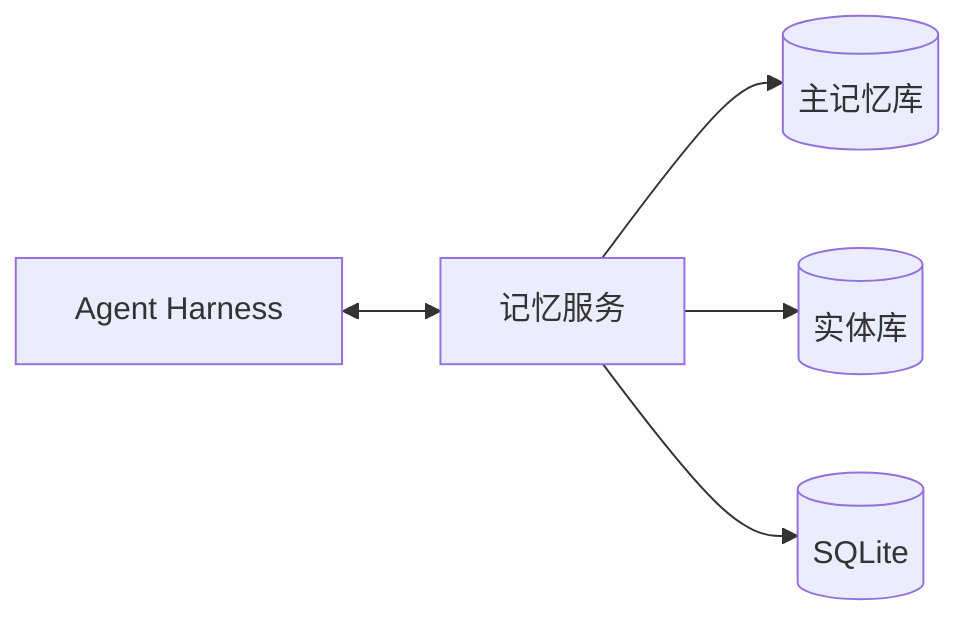
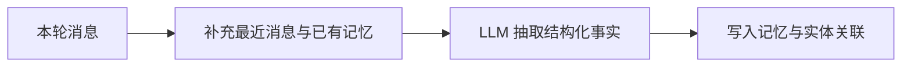
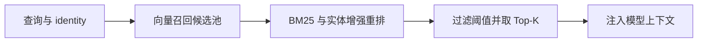

如果用户在周一告诉 Agent：“我最近特别想吃火锅。”周三新开会话时，Agent 能否记住这条念头？

如果系统只把当前会话历史带给模型，而没有在新会话中重新加载旧记录，答案通常是否定的。模型只能根据本次请求收到的上下文生成结果。要让信息跨会话延续，系统需要把关键事实保存到会话之外，并在相关请求中检索出来，放入当前的模型上下文。

最直观的实现是“加一个向量数据库”。继续往下做，很快就会遇到更多问题：如何筛选值得保存的事实？同义信息如何去重？多用户数据如何隔离？明明存入的内容，为什么检索时偏偏找不到？

以 Mem0 的架构为例，一个可靠的 Agent 长期记忆系统，更像是一条完整的数据管线：

> 消息输入 → 记忆摄取 → 分层存储 → 候选召回 → 混合重排 → 注入 Agent 上下文

## 为什么聊天记录不能充当长期记忆

从一次 API 调用来看，LLM 不会自动携带上一次请求的状态。Agent 框架通常通过重新发送历史消息来维持对话连续性，但这种做法有明显边界：

- **上下文开销持续增长**：历史越长，每次调用需要携带的 token 越多。
- **跨会话需要额外加载**：新会话不会自然继承旧会话中的偏好或习惯。
- **原始记录包含大量噪声**：寒暄、临时决策和工具结果并非都值得长期保存。

长期记忆还要处理持久化、身份作用域（identity）、更新与删除，以及检索的相关性与可审计性。它保存的通常也不只是原始聊天，还包括经过提炼、可以独立理解的事实。

## Agent Memory 的架构分层

在这一架构中，Agent Harness 提供本轮消息、identity 和时间，并决定何时摄取、何时检索；记忆服务负责抽取、保存、召回和排序。

三个存储层承担不同职责：

### 主记忆库：记住了什么

存放可以独立检索的短事实，以及对应的向量与元数据，例如创建时间、归属 identity 和 memory hash。向量搜索提供语义召回能力，让系统有机会找到“最近馋火锅”和“想吃顿火锅”这类用词不同但含义相近的内容。

### 实体库：关联对象

从记忆中抽取成都、人名或项目等实体，并把实体与相关记忆连接起来。重排时，这种关联可以转化为 entity boost，作为向量相似度和关键词匹配之外的一路排序信号。

### SQLite：短期与审计

记录最近的消息和系统的变更日志。当抽取模型需要理解“它”“刚才那个项目”等指代时，最近消息可以补上局部上下文。SQLite 与向量库承担不同职责：前者保存近期过程和变化，后者负责跨会话的语义召回。

## 记忆摄取：从原始消息到结构化事实

记忆摄取通常在 Agent 处理完一轮工作后触发。一条简单路径是把输入消息直接向量化并保存（`infer=false`）：实现成本低，也保留了原文，但会把重复信息和临时讨论一起带进长期记忆。

另一条路径是让 LLM 先提炼值得长期保存的事实，再输出结构化结果（`infer=true`）。它适合需要去噪、补全指代和关联实体的场景，同时也会引入额外的模型成本和抽取错误风险。

最近消息、已有相关记忆、当前日期和 identity，可以帮助模型判断一条信息是否新颖、代词指向什么，以及它属于哪个作用域。摄取阶段如果没有明确 identity，多用户或多 Agent 系统就可能在后续检索中混入其他作用域的记忆。

抽取结果写入时还会附加时间、identity、memory hash 和用于关键词检索的归一化文本。hash 只能识别文字完全相同的记录，无法判断“想吃火锅”和“馋四川火锅了”是否表达同一件事，因此不能代替语义合并策略。

## 检索：不只是一次向量搜索

检索的目标，是在正确的 identity 作用域中选出少量适合注入上下文的记忆。整个过程可以分成四步：

第一步先根据 identity 限定检索范围，再使用与建库相同的 embedding 模型把 query 向量化。

这里不会直接取最终 Top-K。讲义拆解的实现会先扩大候选池：

$$
N = \max(4K, 60)
$$

- $K$ 是最终需要返回的记忆数量；
- $N$ 是进入重排阶段的候选数量。

扩大候选池的原因很直接：向量相似度只提供语义信号。某条记忆的初始向量排名不高，但它可能包含完全匹配的关键词，或者与查询中的实体直接关联。如果过早截断，这些记忆没有机会在后续阶段被重新发现。

候选形成后，系统组合三类分数：

- 向量分数回答“意思像不像”；
- BM25 回答“关键词是否准确匹配”；
- 实体增强回答“是否围绕同一个人、地点或对象”。

讲义中的示例把最终分数写成：

$$
S = \frac{S_{vector} + S_{BM25} + S_{entity}}{2.5}
$$

其中向量分数和 BM25 分数归一化到 $[0,1]$，实体增强最高为 $0.5$。分母 2.5 对应三个分量的最大总和。

这套公式适合理解混合重排的思路，但不应直接当作所有系统的固定参数。候选数量、各路权重和过滤阈值，都需要根据自己的查询集评估。

## 真正困难的是记忆进入上下文之后

检索结果“看起来相关”，不代表它适合交给模型。

长期记忆系统至少还要处理下面几件事。

### 查询重写

用户的问题往往包含大量对话表达，例如“我之前说的那个地方”。记忆库保存的却可能是“用户想去成都吃火锅”。在检索前把问题重写成明确、独立的 query，可以减少代词和无关词的干扰。

查询重写通常更适合放在 Agent Harness，而不是写死在存储层。Harness 了解当前任务，也更清楚哪些信息可以补入查询。

### 删除和更新

删除一条记忆不能只删向量。主记忆、实体关联、关键词索引和审计日志可能都需要同步更新。否则系统表面上已经“忘记”，关联实体仍可能在重排时把旧信息带回来。

更新同样需要语义判断。用户从“想吃火锅”改成“最近上火，先不吃火锅”，系统应当覆盖、追加还是保留时间线，取决于业务需要。

### 来源和可解释性

每条注入模型的记忆最好带有来源、创建时间、更新时间和作用域。这样才能回答：这条记忆是谁说的、什么时候产生、为什么被召回、是否仍然有效。

没有来源信息，错误记忆一旦进入 prompt，就很难区分是模型推理错误、抽取错误，还是检索错误。

### 评测错误注入率

记忆系统不能只看召回率。召回少一条信息，Agent 可能只是回答得不够个性化；把另一个用户的事实或一条过时信息注入上下文，却可能直接改变后续工具调用。

因此，评测至少要同时观察精确率、召回率、延迟、token 成本和错误注入率。

## 怎样实现一个可验证的最小版本

如果要自己实现 Agent Memory，可以从一条较短的路径开始：

1. 用 SQLite 保存最近消息和结构化记忆，先验证 identity 隔离。
2. 用小模型把消息抽取成 JSON，并保存时间、来源和 hash。
3. 接入向量索引，建立一组固定查询验证语义召回。
4. 加入 BM25，比较“只用向量”和“向量加关键词”的差异。
5. 最后再加入实体抽取、实体关联和混合重排。
6. 补齐删除、更新、审计和查询重写，再考虑多 Agent 共享。

模型不必一开始就追求最大。讲义建议把 1B 到 12B 的小模型作为结构化抽取的起点，并根据语言和领域选择 embedding 模型。具体选型仍要用自己的数据评估，尤其关注模型是否能稳定输出结构化结果，以及同义表达下的检索表现。

`max(4K, 60)`、最近若干条消息和固定的分数组合，都只是一个实现起点。真正决定系统质量的，是它能否在跨会话、同义改写、实体歧义、信息更新和删除之后，持续返回正确、可解释、属于正确作用域的记忆。

Agent 会不会“长期记住”，最终取决于三件事：保存了什么，怎样把它找回来，以及它是否应该出现在这一次上下文中。

延长聊天记录只能暂时延后遗忘。长期记忆系统要做的，是把遗忘变成一套可以观察、评测和治理的工程过程。

参考资料：[Mem0 文档](https://docs.mem0.ai/) · [Mem0 GitHub](https://github.com/mem0ai/mem0) · [MTEB Leaderboard](https://huggingface.co/spaces/mteb/leaderboard)
