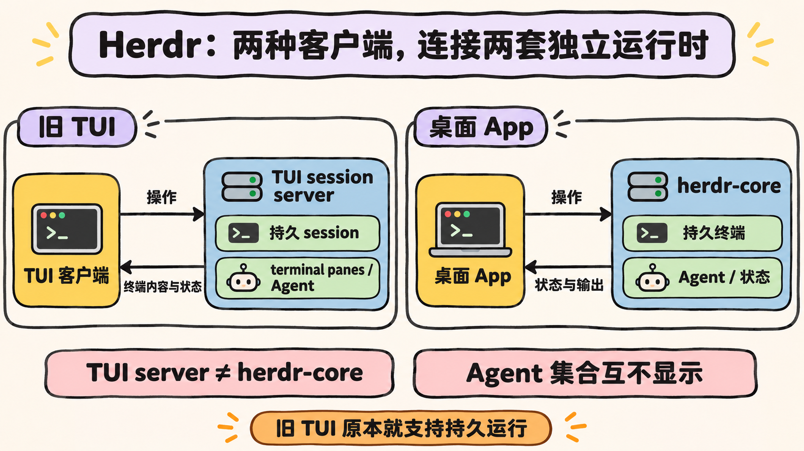
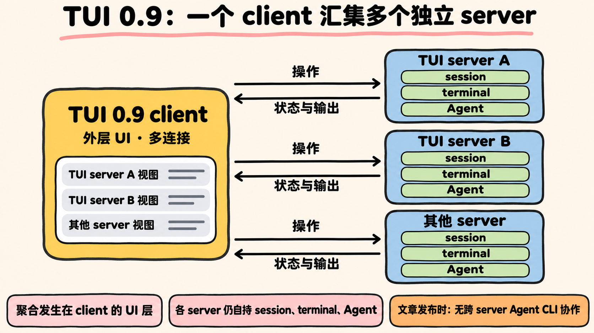

Herdr 是一个围绕持久化终端运行时构建的 Agent 管理系统。这里的 TUI（Terminal User Interface，终端文本界面）指在终端里使用的文本用户界面；CLI coding agent 则是通过命令行启动、执行代码编写或分析任务的程序。Herdr 把这类程序放进可持续运行的终端，再提供界面来组织、查看和操作它们 [Herdr is joining Y Combinator](https://herdr.dev/blog/herdr-is-joining-y-combinator/)。

## 1. Herdr 是什么

Herdr 用 project、tab 和 pane 组织任务：一个 project 包含多个 tab，一个 tab 又包含多个终端 pane。Agent 直接运行在 pane 中，输出和交互也留在这里。开发者可以按项目查看 Agent，并通过 `working`、`done` 和 `needs you` 判断它正在工作、已经完成，还是在等待回应 [herdr-core](https://herdr.dev/core/)。

pane 是这套结构里直接承载进程的单元，tab 用来归拢相关 pane，project 再把 tab 放到具体项目下。开发者看到的不只是一个 Agent 名称，还包括它所在的项目与终端位置。这样一来，任务、输出和需要继续输入的终端可以对应起来 [Herdr is joining Y Combinator](https://herdr.dev/blog/herdr-is-joining-y-combinator/)。

这套结构把原本散落在终端里的任务变成可以定位的对象。界面负责呈现状态和传递操作，终端运行时则保存终端实例并运行 Agent。客户端不必承担终端进程本身，运行时也不等于用户看到的界面。理解这层分工，是区分旧 TUI、TUI 0.9 多机改造和桌面 App 的基础。

## 2. 它解决了哪些工作场景的问题

当 Agent 分布在不同项目、终端 pane 或远程机器上时，开发者需要知道任务在哪里、处于什么状态，以及是否正在等待人工输入。Herdr 的项目层级和状态显示，就是为了让这些信息集中呈现，而不必只靠终端标签和记忆寻找任务。

三个状态分别回答不同问题：`working` 表示程序仍在执行任务，`done` 表示这轮工作已经结束，`needs you` 则提醒开发者 Agent 正在等待回应。开发者可以据此找到需要关注的终端，再进入对应的 pane 查看输出或继续交互。这些状态描述的是 Agent 当前所处的阶段，不改变任务实际运行的位置。

不过，持久运行并不是桌面 App 首次带来的能力。原 TUI 已经有后台 session server：终端 pane 始终运行在 server 中，TUI client 负责把内容显示在终端窗口里，并把用户操作传回 server。用户 detach 后，pane 和其中的 Agent 仍会继续运行；之后再 attach，就能回到原来的 session [How to work with Herdr](https://herdr.dev/tui/docs/how-to-work/)。因此，客户端断开与任务是否继续运行，在原 TUI 架构中已经是两件事。

这一区分也关系到 Herdr 要解决的范围：它不只是替终端增加一个任务列表，还要让运行中的 pane 不依赖某个前台客户端持续打开。查看状态、输入指令和承载进程分别由对应部分负责，开发者重新连接时面对的仍是 server 中原有的 session。

## 3. 为什么增加 App 与 herdr-core

作者说明，TUI 从未被设定为 Herdr 的唯一客户端。部分交互想法很难在终端中实现，于是 Herdr 增加了 `herdr-core`，把持久终端运行时与具体界面分开。`herdr-core` 持有终端实例、运行 Agent，并向客户端报告状态；桌面 App 连接的正是这个运行时。官方同时用手机 App、编辑器面板和 Stream Deck 等例子说明 API 可以支持的客户端形态，但这些例子本身不表示相应产品已经交付 [Herdr is joining Y Combinator](https://herdr.dev/blog/herdr-is-joining-y-combinator/)。

换句话说，增加 App 的直接背景是交互形式，而不是原 TUI 无法保持后台任务。`herdr-core` 提供运行时和 API，App 负责把其中的终端与 Agent 状态呈现出来。把两者分开后，官方可以讨论不同客户端如何接入同一类运行时能力；至于已经交付了哪些客户端，仍应以现有资料为准。

需要注意的是，桌面 App 与旧 TUI 目前不是同一套 Agent 视图。App 连接 `herdr-core`，旧 TUI 使用自己的 TUI server；两边分别管理各自启动的 Agent，彼此不会显示对方的集合 [Herdr App FAQ](https://herdr.dev/tui/docs/worktrees/)。因此，增加 App 改变的是客户端形态和它所连接的运行时，并不意味着旧 TUI 中的 Agent 自动出现在 App 里。

*图 1：旧 TUI 与桌面 App 分别连接 TUI server 和 herdr-core，两组 Agent 互不显示。*

## 4. 为什么保留 TUI

增加桌面 App 不等于放弃 TUI。官方仍把 TUI 作为一等界面，原因之一是它的 bundled 特性：界面与任务所在的终端环境放在一起。代码和计算资源位于 VPS 时，开发者可以通过 SSH 登录远端机器，直接在终端中使用 Herdr；也可以通过 `herdr --remote` 进入远端工作环境 [Herdr is joining Y Combinator](https://herdr.dev/blog/herdr-is-joining-y-combinator/)。

对这类远端环境来说，TUI 的入口就是已有的终端连接，不需要先把任务搬到桌面端，也不依赖远端机器提供图形界面。这里的重点不是宣称 TUI 比 App 更好，而是两者所处的交互环境不同：一个直接位于终端工作流中，另一个提供终端之外的界面。

这也解释了两种界面为何同时存在。桌面 App 承载那些难在终端里实现的交互；TUI 则继续服务于 bundled、VPS、SSH 和 `herdr --remote` 场景。保留 TUI 不是为了补上持久运行能力——这项能力原本就在它的 session server 中——而是因为终端界面仍与远端任务的运行位置直接相连。

## 5. TUI 0.9 与桌面 App 区别

TUI 0.9 的多机改造发生在旧 TUI 产品线内部。改造前，一个 TUI client 只能连接一个 server；如果要查看不同机器上的 Agent，用户需要分别打开客户端或终端标签，并自行区分任务位置 [Connecting the machines](https://herdr.dev/blog/connecting-the-machines/)。

改造后，外层 UI 从 server 移到 TUI client。一个 client 可以连接并聚合多个彼此独立的 server，把它们的状态放进同一个界面。但聚合只发生在显示和操作这一层：每个 server 仍持有自己的 session、terminal 和 Agent，它们没有因此合并成一套运行时或共享一组 Agent。文章发布时，跨 server 的 Agent CLI 协作也尚未完成 [Connecting the machines](https://herdr.dev/blog/connecting-the-machines/)。

*图 2：TUI 0.9 只在 client 聚合显示，各 server 仍保留各自的 session、terminal 和 Agent。*

因此，TUI 0.9 改变的是连接关系：过去是一个 client 对一个 server，后来是一个 client 汇集多个 server。session、terminal 和 Agent 的归属没有移到 client，也没有从多个 server 汇入某个共同 server。界面可以同时呈现多处状态，与底层任务彼此独立并不矛盾。

桌面 App 走的是另一条路径：它是连接 `herdr-core` 的新客户端。前者调整了原 TUI 中 client 与 server 的职责，后者则使用另一套运行时。两者都涉及客户端与运行时的分工，但不能据此把它们视为同一次改造。

## 6. 结论

从这些资料可以概括：Herdr 的变化重点不是首次让 Agent 持久运行，而是重新安排运行时与客户端的关系。旧 TUI 早已有 session server，detach 后 pane 仍继续运行；TUI 0.9 又把外层 UI 移到 client，使它能够聚合多个独立 server。各 server 依然保存自己的 session、terminal 和 Agent，发布时也还没有跨 server 的 Agent CLI 协作。这是根据官方资料作出的架构归纳，不代表这些独立部分已经在底层合并。

桌面 App 则连接 `herdr-core`，与使用 TUI server 的旧 TUI 管理两组互不显示的 Agent。作者增加 App，是因为部分交互难以放进终端；继续保留 TUI，则是因为 bundled、VPS、SSH 和 `herdr --remote` 仍有明确用途。由此看，Herdr 目前提供的是两条边界清楚的使用路径，而不是两套运行时已经统一，也不是两边共享 Agent。
