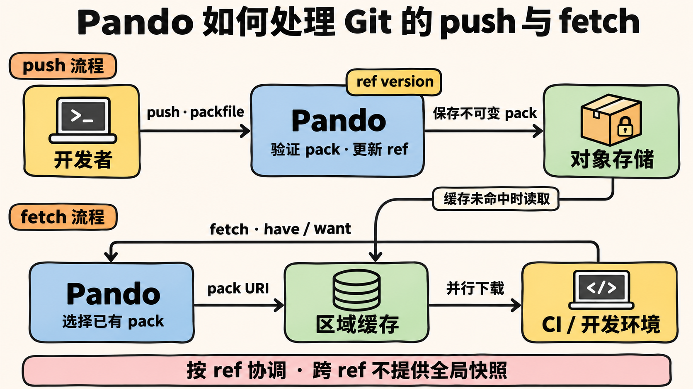

大家好我是 Ray。

一位工程师同时让几个 Agent 修改代码，可能会带来一串并行的 push。每次 push 又可能触发多组 CI，而这些任务往往要反复读取相同的代码历史。写入和读取同时增加，Git 服务就得花更多资源生成 pack、协调仓库状态。

OpenAI 最近介绍了内部 Git 后端 Pando。Pando 把写入协调缩小到单个分支引用（ref），并保留 push 时产生的 packfile，供后续 fetch 复用。不同分支因此可以并行更新，读取时也能复用已有数据，减少重复打包。

## 一次 push：保存 pack，更新 ref

以 feature branch 的 push 为例。客户端把新增对象打成 packfile 发给 Pando。Pando 一边接收、一边验证，再把 packfile 作为不可变数据流写入对象存储。它不必先把这次 push 应用到本地 Git 仓库。

同时，Pando 会为这次更新创建一个 ref version，记录新提交的位置、提供数据的 pack，以及它依赖的早期版本。随后，metadata store 在一个事务中写入新版本，并原子更新对应 ref 的当前指针。事务成功，push 才算完成。

这个指针只对应一个 ref。两位开发者同时更新 `feature-a`，系统仍要协调提交顺序；如果一位更新 `feature-a`，另一位更新 `feature-b`，两次更新就不必争用同一个仓库级写入点。

Pando 把写入竞争限制在单个 ref，让互不相关的分支可以并行推进。OpenAI 称，同步元数据写入只需要固定数量的读写，即 O(1)。不过，文章没有公开 metadata store 的具体实现、事务隔离级别和跨区域故障恢复细节；这些仍属于 OpenAI 对自身架构的披露。

## 为什么 push 时只公布一个基线 ref

Git 客户端推送前，会询问服务端已经有哪些 refs。服务端公布得越多，客户端越能排除服务端已有的对象，上传的 pack 通常越小。但这个 pack 也就越依赖那些已公布的 refs，之后更难被其他客户端直接复用。

Pando 对新 feature branch 通常只公布一个指定的 trunk 作为基线。这样客户端的 pack 依赖关系比较简单，Pando 也更容易判断：哪些读者已有 trunk 历史，可以直接使用这次 push 产生的 pack。

代价是，在同一分支上连续 push，或者从 feature branch 再堆叠分支时，客户端可能重复上传 trunk 之外的对象。OpenAI 文章称，在他们的 monorepo 工作负载中，这一策略下 push pack 的中位数低于 20 KiB，P99 低于 3 MiB。这是特定内部工作负载的结果，不是 Git 协议保证，也不能直接当成其他团队的预期值。

## 一次 fetch：找出已有 pack 并行下载

传统 Git 服务通常要根据客户端已有的对象和目标提交计算差集，再为这次请求现场生成 pack。请求越多，服务端重复遍历对象和压缩数据的工作也越多。

Pando 的做法是尽量复用 push 时已经保存的 pack。客户端 fetch 时会告诉服务端自己有哪些提交（`have`），以及想获取哪些提交（`want`）。Pando 把这些信息映射到 ref versions，选择能够覆盖缺失历史的一组 pack，然后通过 Git 的 `packfile-uri` 能力把下载地址交给客户端。

客户端可以并行从这些 URI 下载 pack。Pando 的响应只带一个空的 inline pack，实际数据通过 URI 传输。区域缓存 Express 遇到缓存未命中时，才从对象存储读取 pack。这样，许多 CI job 读取同一段历史时，服务端不用为每个任务重新压缩对象，缓存也能直接交付已有 pack。

push 产生的 pack 也成了后续读取可以复用的数据。客户端可能因此收到自己已经拥有的对象；Pando 接受这部分重复传输，以减少服务端现场打包的工作。

## 并行写入的另一面：没有仓库级快照

Pando 对单个 ref 的更新可串行化。读取某个 ref 时，读者也会看到产生该版本所依赖的历史。这种保证可以理解为因果一致性：一个版本不会缺少它所依赖的前序内容。

但 Pando 不承诺一次读取所有 refs 时，看到的都是仓库在同一个瞬间的状态。假如 `foo` 和 `bar` 在 clone 协商期间分别更新，客户端可能读到 `foo` 的较新版本和 `bar` 的较旧版本。另一个客户端也可能看到相反组合。

许多日常开发操作只需要一条分支的历史完整。如果系统要求多个 refs 必须原子切换，就要评估这种读取语义是否合适。Pando 通过缩小协调范围来支持并行写入，同时不提供跨 ref 的统一时间点快照。

## Compaction：别让 fetch 面对成千上万个小包

如果 trunk 一天产生数万个 push pack，落后很多的客户端就可能需要下载太多小 pack。Pando 在后台把这些 pack 组织成多层 cover：底层保存较小范围的 push 结果，上层逐渐覆盖更大的 ref version 区间。

这有两个作用。一方面，后台 worker 可以把一个 cover 重组为更大的 pack，提高压缩效率；另一方面，fetch planner 可以像跳表一样跨过较长的版本区间，不必逐个检查每次 push。客户端落后多久，Pando 就可以选择适合的层级和 pack 组合。

OpenAI 称其 monorepo 当前使用到 L4。文章也表示，各层 pack 会被保留，fetch 时按客户端已有版本选择合适的层级。至于长期存储放大、对象删除和保留策略，公开文章没有给出完整答案。

## 和 WALGit、GitLab 的差别在哪里

Pando、Cursor 描述的 Continuity/WALGit 思路，以及 GitLab 的 Scaling Git 设计，都使用不可变对象、对象存储和缓存，差别在于它们如何协调写入、定义读取视图。

Pando 按 ref 更新，允许不同 refs 并行推进，跨 ref 读取不保证是同一时刻的快照。WALGit 通过仓库级 manifest/CAS 发布一条提交序列；GitLab 的设计则围绕 generation 和 MVCC snapshot，目标是读到一致的仓库视图。它们不是同一个架构的不同名字，也不能只凭公开材料做简单的性能排名。

Pando 的机制可以概括为：push 时保存不可变 pack，由 metadata 在对应 ref 上协调更新；fetch 时选择已有 pack，再通过 URI 和缓存交付。写入按 ref 分开协调，读取复用已有数据，减少了每次 fetch 都现场打包的工作。

OpenAI 称，Pando 已承载其 monorepo 的全部开发流量，中位 push 延迟改善近 5 倍，每天交付接近 1 PB Git 数据。这些数字来自 OpenAI 的生产环境说明；文章没有提供完整硬件配置、成本或可复现实验。其他团队可以参考它采用的机制和取舍，但实际性能仍取决于各自的工作负载与实现。

资料：[Scaling Git at OpenAI](https://openai.com/index/scaling-git-at-openai/)、[Git protocol v2](https://git-scm.com/docs/protocol-v2)、[GitLab Scaling Git 设计](https://handbook.gitlab.com/handbook/engineering/architecture/design-documents/scaling-git/)、[Git at any scale](https://cursor.com/blog/git-at-any-scale)、[WALGit](https://github.com/tobi/walgit)。
