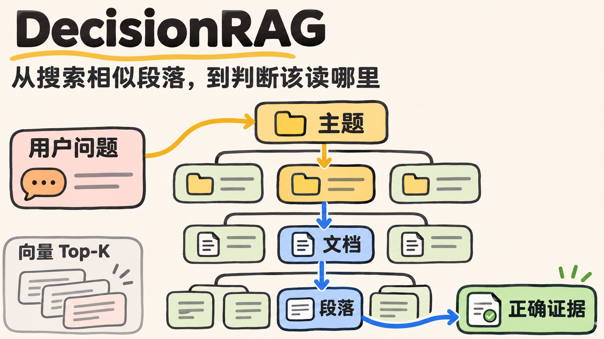
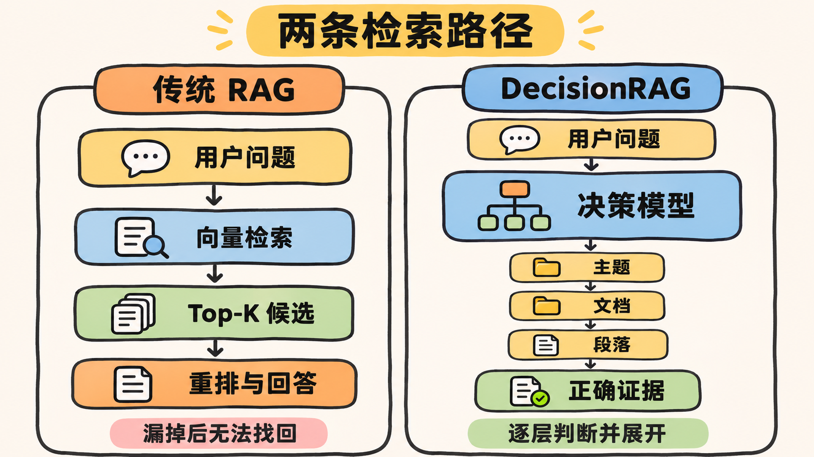
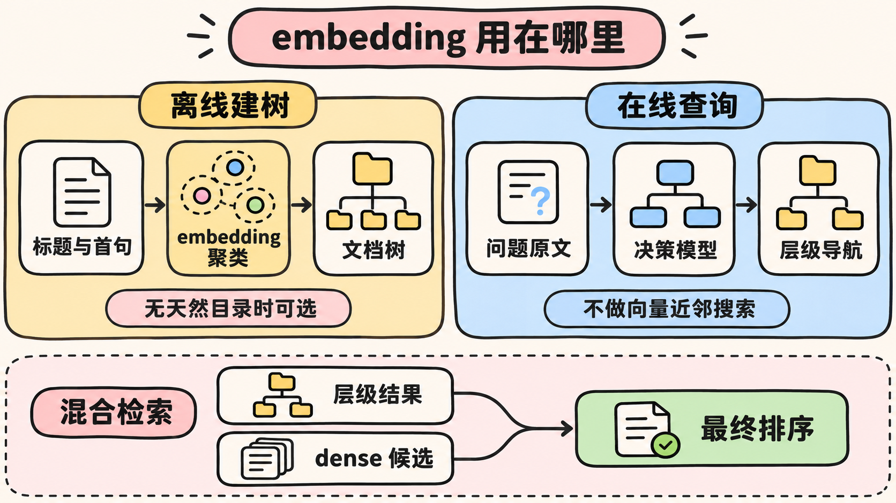

一个 RAG 系统回答错了，我们很容易把注意力放在生成模型上：是不是模型不够强？提示词要不要再改？上下文是不是给少了？

但有一类错误发生得更早。

如果正确文档在检索阶段就没有进入候选集，后面的 reranker 和生成模型再强，也没有机会看到它。

这正是 DecisionRAG 想解决的问题。

它没有继续训练一个更好的向量检索器，也不只是给现有检索结果增加一次判断。它换了一条路：让决策模型沿着文档层级逐步判断，从主题进入文档，再进入章节和段落，最后找到可以回答问题的证据。

这套方法来自 2026 年 10 月提交的论文 *Retriever-Free Retrieval: Navigating Documents with Decision Models*。论文仍是 arXiv v1 预印本，下面提到的效果均为作者报告结果，目前还没有官方代码和独立复现可供核对。[论文与版本记录](https://arxiv.org/abs/2610.35868)

## 强大的 LLM，为什么仍会被检索器卡住

传统 RAG 的检索链路通常是：

```text
用户问题
   ↓
BM25 或向量检索
   ↓
Top-K 候选段落
   ↓
reranker
   ↓
生成模型回答
```

reranker 只能重新排列已经找到的候选，生成模型也只能阅读传给它的内容。

假设用户问：“克里斯托弗·诺兰在 2000 年执导的电影，主角是谁？”

关键词检索可能被“2000 年”和“电影”吸引，找到《角斗士》之类表面匹配的页面。向量检索虽然比关键词更懂语义，也仍然是在固定的 embedding 空间里寻找相似内容。如果《记忆碎片》的相关段落没有进入 Top-K，后面的模型就无法回答 Leonard Shelby。

这不是生成模型的知识或推理问题。证据在第一步就丢了。

DecisionRAG 对这个问题的判断是：既然最终生成模型已经具有较强的语言理解能力，检索阶段也应该使用更接近语言理解的判断，而不是完全依赖词项重合或向量距离。

## 把搜索改成沿目录导航

DecisionRAG 先把语料看成一棵树：

```text
主题或产品
  └─ 文档
      └─ 章节
          └─ 段落
```

叶子节点是可以交给生成模型的段落，内部节点可以是产品、主题、文档或章节。每个节点都有一段简短描述，例如主题摘要、文档标题或章节标题。

收到问题后，DecisionRAG 不会立即把问题转成 query embedding，再去向量数据库里找最近的段落。它先把顶层候选交给决策模型，并针对每个候选提出一个二元问题：

> 为了回答当前问题，是否值得继续探索这个分支？

决策模型不生成一段解释，而是直接返回每个候选的 `P(Yes)`。系统保留得分最高的若干分支，展开它们的子节点，然后重复同样的判断。

用前面的电影问题举例，模型可能在第一轮保留 “Christopher Nolan” 和 “Memento”，放弃只有表面关键词重合的其他电影页面；进入文档后，再判断哪些章节和段落值得阅读。

整个流程变成了：

```text
问题
  ↓
判断哪些主题值得进入
  ↓
判断哪些文档值得展开
  ↓
判断哪些章节和段落相关
  ↓
可选的最终精排
  ↓
生成模型回答
```



这更像人在图书馆里找资料。我们不会一开始就把整座图书馆的每个段落做一次相似度排序，而是先选区域，再看书名和目录，最后翻到具体页面。

## 共享上下文为什么重要

DecisionRAG 的关键不只是“让模型判断相关性”，还在于让一批候选出现在同一个共享上下文中。

如果分别询问模型：“文档 A 是否相关？”“文档 B 是否相关？”每个文档单独看都可能有一点关系，模型容易给出一组都不低的分数。

共享上下文把问题和候选 A、B、C、D 一起交给模型。一个单独看似相关的候选，在出现更合适的替代项后，相关性概率会下降。候选之间有了参照，分数也更适合直接比较。

论文的消融实验显示，在 MultiDoc2Dial 中，把选中页面的段落放在一起评分，而不是逐页独立评分，R@1 从 36.7% 提高到 44.4%。这说明效果并不只来自换了一个更强的模型，共享候选的比较方式也是核心设计。[论文 §6.1](https://arxiv.org/html/2610.35868#S6.SS1)

同时，DecisionRAG 使用的是非生成式判断。模型一次前向传播就能输出多个候选的结构化概率，不需要像普通 LLM Agent 那样，在每一层生成分析过程和选择结果。作者用相同层级做过对照：生成式导航没有带来稳定的准确率优势，却慢了 34 至 145 倍。[论文 §6.3](https://arxiv.org/html/2610.35868#S6.SS3)

## 它不只是给向量检索增加一个判断器

看到这里，一个自然的疑问是：这不就是向量检索加一个 judge 或 reranker 吗？

区别在于第一批候选从哪里来。

| 方案 | 候选从哪里来 | 判断模型的能力边界 |
|---|---|---|
| 传统 RAG + reranker | BM25 或向量检索的 Top-K | 只能重排已有候选 |
| DecisionRAG | 文档树当前节点的所有子节点 | 决定展开哪些分支，逐层产生新候选 |
| DecisionRAG + dense candidates | 层级导航与向量检索结果的并集 | 合并两路证据后共同判断和排序 |

传统 reranker 位于首阶段检索之后。首阶段漏掉的文档，它看不到。

DecisionRAG 的决策模型直接参与候选生成：它先决定进入哪些主题和文档，再从这些分支中找到段落。这是一条独立的检索路径，不是传统流水线末端多加一步。

层级结构让这件事在大语料上变得可行。模型不必直接阅读数百万段落，只需在每一层判断有限数量的节点。按照论文的理想化模型，如果树大致平衡，串行判断次数主要由树深决定，而不是由全部段落数量直接决定。总计算量仍然会随每层候选数增长，所以这并不等于“语料再大也没有成本”。[论文 §3.4](https://arxiv.org/html/2610.35868#S3.SS4)

## DecisionRAG 到底有没有 embedding

“DecisionRAG 没有 embedding”这句话容易造成误解。

更准确的表述是：**它不依靠 query embedding 与 passage embedding 的近邻搜索产生在线首阶段候选，但在语料没有天然层级时，可以使用 embedding 离线建树。**

如果企业知识库本身就有清晰结构，例如：

```text
产品 → 使用手册 → 章节 → 段落
```

DecisionRAG 可以直接利用这些目录、标题和元数据，不需要先为所有段落建立向量索引。

如果语料是十万篇没有上层目录的扁平文档，系统仍然需要一种方式把它们组织成可以导航的树。论文在 Natural Questions 实验中使用 `e5-base-v2` 编码 Wikipedia 页面的标题和首句，通过 k-means 聚成 1,000 个簇，再用 Qwen3-8B 为每个簇生成一句话描述。[论文 §4.1](https://arxiv.org/html/2610.35868#S4.SS1)

这里的 embedding 用于离线组织语料。用户查询到来时，系统不再计算 query embedding 与这些页面向量做近邻检索，而是让决策模型阅读问题和节点描述，逐层选择路径。

可以把两种方案的差别概括为：

- 向量 RAG 问的是：哪些段落在 embedding 空间中与问题最接近？
- DecisionRAG 问的是：为了回答这个问题，下一步最值得阅读哪个主题、文档或章节？

所以，DecisionRAG 改变的是在线检索范式，不是宣布 embedding 从整个数据处理中消失。



## 论文结果说明了什么

论文在四个基准上比较了 DecisionRAG、BM25、稀疏检索、Qwen3-Embedding-8B，以及使用 BGE、Qwen3-Reranker-8B 和 GPT-5 的重排方案。

在不做任务专属训练的主实验中，DecisionRAG 相对“Qwen3 向量检索 + 8B reranker”，在 MultiDoc2Dial 的 R@1 上提高了 13.8 个百分点，在 Natural Questions 的 Hit@1 上提高了 17.4 个百分点。[论文 Table 2](https://arxiv.org/html/2610.35868#S4.T2)

作者报告的在线中位检索延迟为每次查询 0.68 至 1.76 秒，API 成本为 0.22 至 2.33 美分。Natural Questions 的语料包含 268 万个 Wikipedia 段落，说明层级导航至少在作者的实验设置中能够扩展到较大语料。[论文 Table 5](https://arxiv.org/html/2610.35868#S5.T5)

这些数字值得关注，但还不能直接推导出“生产环境比向量检索更快”。论文中的 Jev 使用托管 API，传统 reranker 则在本地 GPU 上运行，硬件、并发和服务条件并不一致。在线延迟也没有计入离线建树成本。

更重要的是，这是一篇 v1 预印本。目前没有作者发布的官方实现、训练脚本或 checkpoint，也没有独立团队复现这些结果。因此它证明的是这个方向值得验证，还没有证明它可以直接替换现有生产检索栈。

## 旧瓶颈变小了，新风险出现了

DecisionRAG 减少了对固定相似度空间的依赖，但没有让检索失败消失。它只是改变了主要失败模式。

传统 BM25 或向量检索可能因为关键词、表达方式或 embedding 空间的限制漏掉正确文档。DecisionRAG 则依赖另一组条件：

- 文档必须有可用的层级，或者能被合理地聚成层级。
- 主题摘要、文档标题和章节描述要足够清楚。
- 决策模型在上层不能过早丢掉正确分支。
- 每层 top-k 预算要在召回率、延迟和成本之间取得平衡。

其中最需要警惕的是不可逆剪枝。一个主题或文档在上层被丢弃后，它下面的所有段落都不会再被查看。论文在 Natural Questions 上发现，只保留 1% 顶层簇时，R@10 会降到 63.7%；增加探索预算可以改善召回，但也会增加成本。[论文 §6.6](https://arxiv.org/html/2610.35868#S6.SS6)

这也是为什么混合方案更接近现实的生产选择。

DecisionRAG 可以沿层级导航，同时保留 BM25 或向量检索作为另一条召回路径，再把两路候选交给最后的判断和排序。论文中的 `+ dense candidates` 版本在多数指标上进一步提高了覆盖率，说明层级导航与向量检索找到的证据具有一定互补性。

对于已经运行稳定的 RAG 系统，可以先保留现有向量检索，建立一套真实查询集，比较三条路径：

1. 现有 BM25/向量检索与 reranker。
2. 只使用 DecisionRAG 的层级导航。
3. 层级导航与传统检索合并候选。

除了 R@k、Hit@1 和最终答案正确率，还需要记录上层剪枝错误、离线建树时间、增量文档维护成本、p95 延迟、并发能力和单次查询费用。只有这些指标在自己的语料上成立，论文结果才真正转化成工程价值。

## 从“搜索相似内容”到“判断该读哪里”

DecisionRAG 最有意思的地方，不是证明向量检索已经过时。

它提出了另一种证据发现方式：不急着把问题和所有段落压进同一个向量空间，而是保留文档原本的主题、目录和章节结构，让模型判断下一步该读哪里。

这种方式特别适合结构清晰的帮助中心、产品文档、政策资料和企业知识库。它也提醒我们，RAG 的质量不只取决于生成模型，更取决于证据在什么阶段、以什么方式进入模型视野。

向量检索的风险是相似度没有找到正确内容；层级导航的风险是走错路后过早关掉了正确分支。

生产系统未必需要在两者之间二选一。更有价值的问题可能是：能不能让向量检索负责广泛召回，让 DecisionRAG 式的导航负责理解结构，再让最终判断模型把两路证据放到一起比较？

DecisionRAG 还没有给出完整的生产答案，但它已经把检索问题换了一个问法。

过去我们问：哪个段落最像这个问题？

现在也可以问：为了找到答案，下一步最应该阅读哪里？

## 参考资料

- [Retriever-Free Retrieval: Navigating Documents with Decision Models](https://arxiv.org/abs/2610.35868)
- [论文 HTML 全文](https://arxiv.org/html/2610.35868)
- [Cornell AI-MI 作者机构公告](https://aimi.cornell.edu/new-ai-mi-supported-preprint-retriever-free-retrieval-navigating-documents-with-decision-models/)
