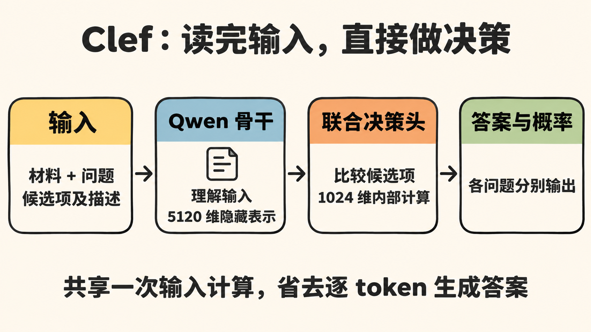
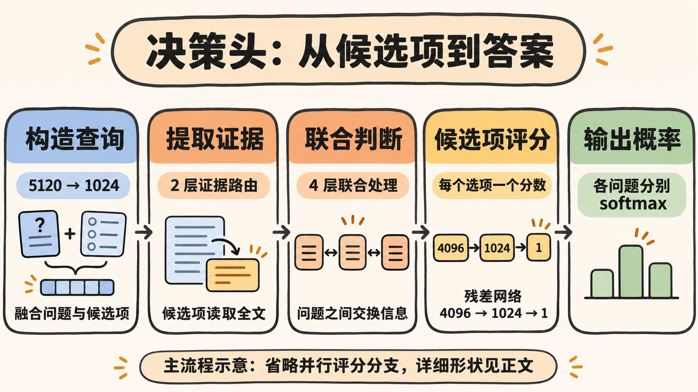

一张工单写着：“生产环境支付接口已中断 20 分钟，所有用户都无法付款。”系统需要判断是否紧急，并决定交给哪个团队。

用聊天模型处理这件事，可以要求它返回 JSON。Clef 则提供了另一条计算路径：把问题和合法候选项随工单一起输入，读完后直接为每个候选项打分。

这引出了几个值得拆开的问题。Clef 的整体结构是什么？它为什么能够省去生成过程？候选项又是怎样与输入中的 token 表示结合的？

下面结合 `01_Clef模型结构.ipynb` 打印出的模型结构，沿一次请求追踪张量的变化。讨论限定在 `Cloudflare/clef` 27B 的固定版本 `171287b2571042abec9e7b99752aee58216b0ed0`。Notebook 使用 meta device 创建模型，没有加载真实权重。因此，本文分析结构与计算路径，不把它当作速度或准确率实测。

## 1. 先看整个模型：理解输入，再给选项评分

Notebook 中最外层的结构很清楚：

```text
ClefModel
├── language_model：Qwen3_5ForConditionalGeneration
│   ├── visual：视觉编码器
│   └── language_model：语言主干
└── head：JointSchemaHead
```

Qwen 骨干负责把材料、问题和选项转换成包含上下文信息的向量。联合决策头接收这些向量，输出每个问题下各个候选项的分数。整体流程如下：



骨干中，视觉编码器有 27 层，内部宽度为 1152，最终映射到 5120 维，与语言主干对接。语言主干有 64 层，隐藏维度为 5120，其中 48 层使用线性注意力，16 层使用完整注意力。纯文本请求可以直接进入语言主干。有图片时，需要先经过视觉编码器。

这些数字来自该版本的[骨干配置](https://huggingface.co/Cloudflare/clef/blob/171287b2571042abec9e7b99752aee58216b0ed0/config.json)。这里按配置中的实际架构类 `Qwen3_5ForConditionalGeneration` 展开，不将其推广到整个 Clef 家族。

决策头的主要配置则是：

| 配置 | 数值 | 含义 |
| --- | ---: | --- |
| `hidden_size` | 5120 | 骨干输出的向量维度 |
| `width` | 1024 | 决策头内部宽度 |
| `routing_layers` | 2 | 候选项提取证据的层数 |
| `layers` | 4 | 多个问题联合处理的层数 |
| `heads` | 16 | 决策头多头注意力的头数 |
| `feedforward` | 4096 | 前馈网络的中间维度 |

Notebook 统计的骨干参数量约为 273.57 亿，决策头约为 1.28 亿。后者只占完整实例参数量的约 0.47%，但参数比例不能直接换算成推理时间比例。

## 2. Clef 为什么快：先看它省去了什么

普通聊天模型即使只输出简短 JSON，也需要逐 token 生成。完成输入的首次计算后，模型还要不断根据已有内容预测后续 token，直到生成完整答案。

Clef 在读完输入后，直接对预先给定的候选项评分。返回 JSON 的工作可以交给普通代码完成。

```text
聊天模型：读取输入 → 生成 token → 生成 token → …… → 完整答案
Clef：   读取输入 → 决策头为所有候选项评分 → 组织响应
```

所以，JointSchemaHead 的作用是让这条直接评分的路径成立。可从结构确认的加速来源，首先是省去了自回归生成答案的循环。同一请求中的多个问题也能共享骨干对输入的一次计算，不必为每个问题分别重读工单。

决策头本身的计算主要在 1024 维空间中进行，后面的联合处理只围绕少量问题节点展开。不过，27B 骨干仍然要读取整段输入。输入变长、候选项增多或加入图片，都会增加计算成本。结构分析不能据此给出固定的延迟或加速倍数。

比较对象也很重要。如果另一种方案同样只对几个候选 token 打分，已经没有长答案生成，那么双方的差距就要看具体模型、实现和硬件。这里能说明的是 Clef 如何缩短输出路径，实际收益仍需要同条件测试。

## 3. 候选项如何进入模型：文本与位置一起编码

回到工单。调用方可以提交两个问题，一个判断紧急性，一个选择处理团队。下面是省略模型 ID 等外围字段后的输入示意：

```json
{
  "state": "生产环境支付接口已中断 20 分钟，所有用户都无法付款。",
  "questions": {
    "urgent": {
      "type": "noul",
      "instructions": "是否需要紧急处理？"
    },
    "team": {
      "type": "choice",
      "instructions": "应交给哪个团队？",
      "criteria": {
        "technical": "接口故障、系统错误",
        "finance": "发票、退款、账务",
        "sales": "产品咨询、购买与升级"
      }
    }
  }
}
```

`noul` 会被编码成 `true` 和 `false` 两个候选项。`choice` 使用调用方提供的选项。本例共有两个问题、五个候选项。

官方编码函数 `encode_record()` 会把它们写进同一条输入序列。一个团队候选项在序列中类似这样：

```text
INSTRUCTION: 应交给哪个团队？
ALLOWED OPTIONS:
OPTION 1: {"description":"发票、退款、账务","option_id":"finance"}
...
```

这意味着候选项的 ID 和描述都会被 tokenizer 转成 token，再送进 Qwen 骨干。候选项本身已经参与了上下文计算。这个实现还会按 `choice` 的选项 ID 排序，因此输入中的顺序可能不同于请求 JSON 中的书写顺序。

编码器同时记录问题和候选项在 token 序列中的起止位置：

```python
question_span = (question_start, question_end)
option_spans = ((start_1, end_1), (start_2, end_2), ...)
```

这些 span 是 token 位置，范围左闭右开，随 `EncodedRecord` 一起传给决策头。决策头按位置取出向量，无需再从工单中识别“哪些词是候选答案”。

记批量大小为 $B$，序列长度为 $L$。骨干输出为：

$$
H\in\mathbb{R}^{B\times L\times5120}
$$

源码中的决策头逐条处理 record，并排除 padding。下文跟踪单条请求，所以省略批量维。设问题数为 $F$，所有问题的候选项总数为 $C$。本例中 $F=2$、$C=5$。

## 4. 两层证据路由：候选项怎样读取输入

决策头先对骨干隐藏表示做 LayerNorm，再根据 span 获取问题与候选项的表示。对于一个包含多个 token 的候选项，它取这些位置的隐藏向量的均值，得到一个 5120 维的上下文表示 $c$。

它还会用同一组 token IDs，查询原模型的输出词表权重，并取均值，得到另一个 5120 维向量 $e$。$e$ 来自固定参数表，同样的候选项 token 序列会得到相同的词汇表示。$c$ 则来自这次请求的骨干计算，会受到上下文影响。两者来源不同。

所属问题的 instruction span 同样通过均值汇总成 5120 维向量 $q$。随后，三种表示分别经过不同的线性层，映射到 1024 维，再逐元素相加：

$$
u=W_c c+W_e e+W_q q
$$

对应的关键代码可以简写为：

```python
option_query = (
    option_context_projection(context)
    + option_lexical_projection(lexical)
    + option_question_projection(question)
)
```

融合后的 $u$ 是这个候选项的查询向量。这里的运算是投影后相加，没有把候选项向量拼接到全文的每一个 token 上。

全文隐藏表示也会经过 `memory_projection`，形成记忆矩阵 $M\in\mathbb{R}^{L\times1024}$。把所有候选项的查询向量排在一起，就得到 $U\in\mathbb{R}^{C\times1024}$。

接下来的两层 `EvidenceRoutingLayer` 使用交叉注意力，让候选项读取全文信息：

```text
Query：候选项查询向量 U    [1, C, 1024]
Key：  全序列记忆 M       [1, L, 1024]
Value：全序列记忆 M       [1, L, 1024]
输出：更新后的候选项表示   [1, C, 1024]
```

注意力会计算每个候选项查询与各个输入位置的匹配程度，再加权汇总输入信息。以“技术团队”为例，它的查询向量同时包含选项描述、当前上下文和“应交给哪个团队”这个问题的信息，随后可以从全文读取与接口故障有关的表示。

这里描述的是计算机制，不能据此断言模型实际关注了哪些词。源码也没有把检索范围限定为工单正文，问题和选项所在的输入位置同样包含在记忆中。

每层还包含残差连接，以及 `1024 → 4096 → 1024` 的前馈网络。两层结束后，候选项数量和向量宽度都不变，仍为 $C\times1024$。

## 5. 四层联合判断：问题之间怎样交换信息

候选项提取证据之后，模型按所属问题将它们拆开。对于每个问题，先计算该问题表示与各个候选项表示的匹配度，用 softmax 得到汇总权重，再对候选项向量加权求和。

这次 softmax 的用途是形成候选项证据摘要，还不是最终答案概率。

每个问题节点由四部分相加形成：问题表示、候选项证据摘要、全局表示，以及问题类型 embedding。全局表示取自最后一个有效输入 token 的隐藏状态。类型 embedding 则区分 `noul`、`choice`、`score` 三种问题。

这样，原来的五个候选项已经分别提供了证据，每个问题也有了自己的 1024 维节点。两个问题进入四层 `TransformerDecoderLayer` 时，张量形状是：

$$
\text{fields}\in\mathbb{R}^{1\times F\times1024}
$$

这些层的 self-attention 发生在问题节点之间，让“是否紧急”和“交给谁处理”的表示相互影响。cross-attention 则让问题节点再次读取全序列记忆，之后通过前馈网络更新。

虽然模块名叫 `DecoderLayer`，这里并不逐 token 生成答案。源码一次传入所有问题节点，也没有传入因果遮罩。这一阶段的序列长度是问题数 $F$。

下面用一张简图串起决策头的主流程。图中省略并行评分分支，各阶段的张量形状在正文中分别说明。



## 6. 从向量到答案：每个候选项一个分数

到了最后一步，每个问题有一个联合更新后的向量 $f$，每个候选项有一个经过证据路由的向量 $o$。决策头结合三部分信息生成 logit。

词汇先验分支仍在 5120 维空间中计算，比较候选项词汇向量与“问题表示加全局表示”的方向相似度。虽然源码称其为 `prior`，它也使用当前输入产生的表示，不能理解成与工单无关的固定先验。

另一部分在 1024 维空间里，直接计算问题向量与候选项向量的余弦相似度。模型还把四组特征拼接起来，让一个小型网络学习额外的匹配关系：

```text
问题向量 f          1024 维
候选项向量 o        1024 维
逐元素乘积 f * o    1024 维
绝对差 |f - o|      1024 维
──────────────────────────
拼接后              4096 维
```

这就是模型打印结果中 `residual_scorer` 的输入维度来源：

```text
Linear(4096, 1024) → GELU → Linear(1024, 1)
```

该网络对每个候选项输出一个残差分数。将词汇先验、余弦匹配和残差分数组合后，最终计算可概括为：

$$
z_{j,k}=\text{prior}_{j,k}
+\sigma(g)\left[\beta\cos(f_j,o_{j,k})+r_{j,k}\right]
$$

其中 $g$ 是可学习门控参数，$\beta$ 是可学习尺度，$r$ 是残差分数。源码还为先验设置了单独的尺度参数。这三个标量不会像子模块一样出现在普通的 `print(model.head)` 中，而 meta 实例也无法告诉我们训练后的数值。

所有分数计算完成后，模型对每个问题单独做 softmax。工单示例会得到一个长度为 2 的紧急性分布，以及一个长度为 3 的团队分布，而不会对五个候选项统一归一化。

三种问题类型共用候选项评分机制，响应阶段再按类型解释概率：

| 类型 | 返回方式 |
| --- | --- |
| `noul` | 返回 `true` 的概率 |
| `choice` | 返回概率最大的选项及各选项概率 |
| `score` | 按等级编号计算概率加权平均，并保留分布 |

这些操作都能在固定版本的[推理实现](https://huggingface.co/Cloudflare/clef/blob/171287b2571042abec9e7b99752aee58216b0ed0/joint_schema_model.py)中对应到具体代码。

候选项来自输入文本，因此同一个决策头可以接收运行时变化的选项，无需为“技术、财务、销售”各自固定一个输出神经元。新增选项仍需要清楚的描述，合法答案也必须提前定义，模型不能在这条路径中自由补出一个新类别。

“联合判断”的边界也在这里。不同问题的表示确实交换了信息，但最终输出仍是各问题分别归一化的分布，没有枚举所有答案组合，也不保证业务约束始终成立。概率的可靠程度，需要在实际数据上评估。

对于工单系统，Clef 可以提供紧急性和团队的判断依据。应用代码仍要定义是否自动升级、何时转人工，并限制不允许执行的组合。省去答案生成的循环之后，系统得到了一条更直接的评分路径。这条路径能节省多少时间、能承担多少自动决策，最终要用真实请求来验证。
