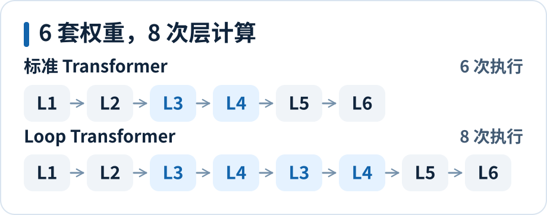
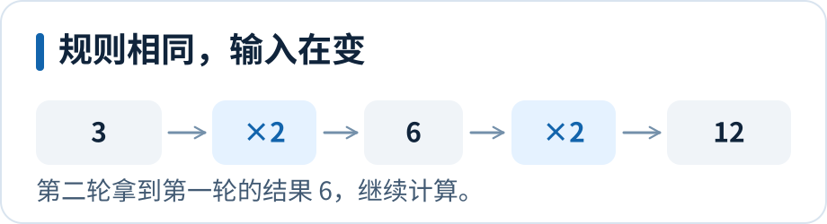
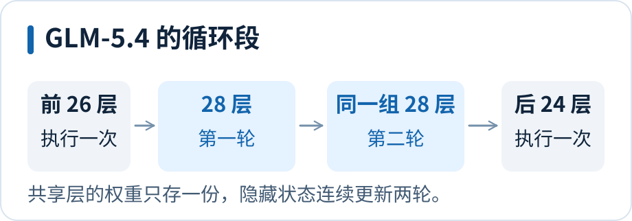
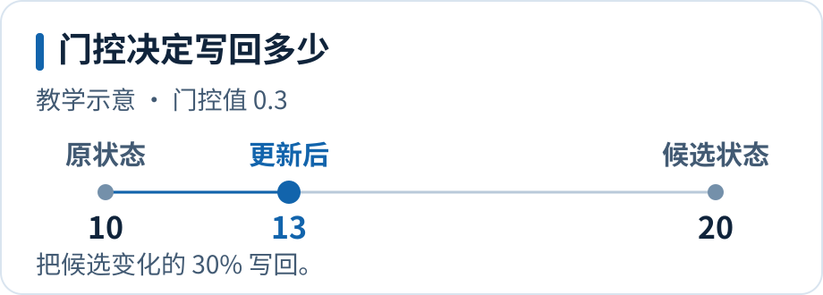
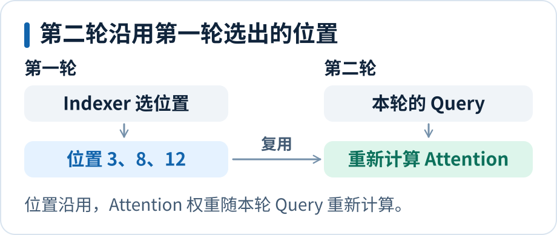
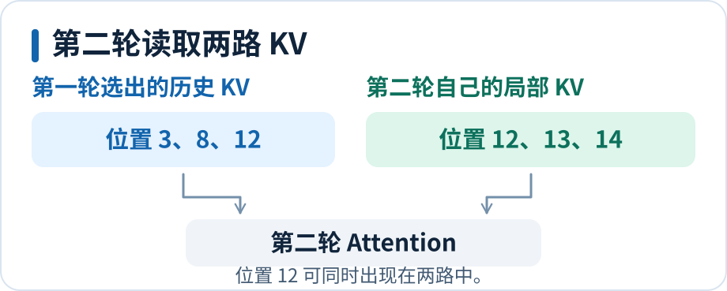
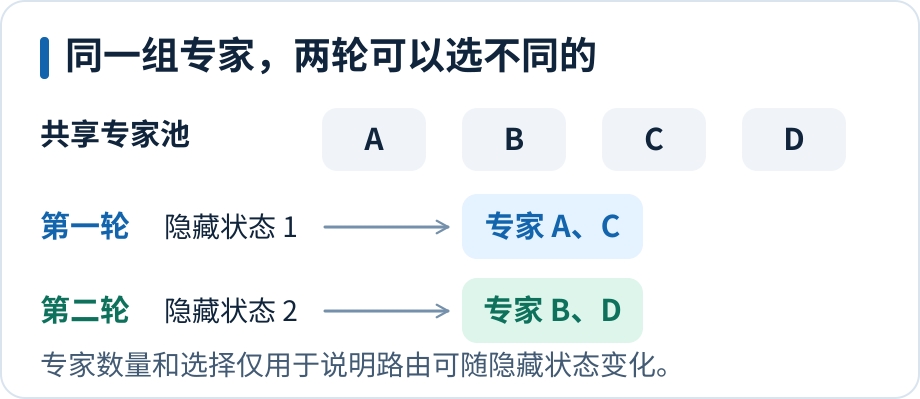

大家好，我是 Ray。

假设一个 Transformer 有 6 层。我们走到第 4 层后，折回去，把第 3、4 层再跑一遍。这样数起来，模型到底有 6 层，还是 8 层？

两个数字都有用。**6 是模型存了多少套层权重，8 是一次前向实际执行了多少次层计算。** 智谱在 GLM‑5.4 上做了类似的事。它从预训练好的 GLM‑5 出发，通过继续训练，让其中 28 层执行两轮。麻烦也随之而来：第二轮拿到了什么输入？它还要不要再存一份 KV Cache？

## 6 套权重，8 次层计算

把第 3、4 层合起来，叫它 **G**。普通模型让隐藏状态通过 G 一次。循环模型让它通过 G 两次，然后再交给第 5 层。循环路径里的两对蓝色方框代表 G 的两次执行，用的是同一组权重。

这里的**隐藏状态**就是模型目前对各个 Token 的向量表示。把整批输入写成 `[B, T, d_model]`，B 是批大小，T 是每条序列的 Token 数，`d_model` 是每个 Token 的向量宽度。循环这一组层时，模型继续更新这些向量。三维张量的形状可以保持原样，里面的数值已经变了。

拿一个简单函数试试。假设 G 只做一件事，把输入乘以 2。输入 3，第一轮得到 6，第二轮拿着 6 继续算，得到 12。实际的 G 是一组带 Attention 和前馈模块的 Transformer 层，计算复杂得多，但数据流一样。**第二轮接着处理第一轮留下的状态。**

## GLM‑5.4 怎样把 28 层跑两遍

智谱公开的做法是让中间 28 层循环两轮。按 Sebastian Raschka 整理的架构，前 26 层和后 24 层各跑一次。这样，78 个独立的层在一次前向里执行了 `26 + 28 × 2 + 24 = 106` 次。这个数字描述的是计算路径的深度。

为什么还需要继续训练？想想循环段后面的第一层。它在预训练时一直处理循环段跑一遍后的结果。现在突然多跑一遍，传过来的向量数值可能落在它不习惯的范围。智谱报告称，在改造时直接把每轮结果写回，会出现激活范数随迭代膨胀的问题。

GLM‑5.4 加了一个**逐 Token 的门控**，控制本轮的候选变化写回多少。举个只看一个数的例子。原状态是 10，候选状态是 20，门控取 0.3，就写入差值的 30%，得到 `10 + 0.3 × (20 − 10) = 13`。这组数字只是演示门控怎么工作。

按智谱的描述，训练后第一轮主要建立上下文，通常写得更保守，第二轮在此基础上进一步更新。门控还能随 Token 改变写入幅度。这里有两个不同的量：**写入多少可以变，公开架构的循环轮数是固定的两轮。**

## 第二轮 Attention 从哪里拿数据？

先回忆 DSA（DeepSeek Sparse Attention）。对当前 Token，Indexer 会给历史位置打分，从中挑出一批位置交给主 Attention。可以把过程拆成两步，**先找位置，再计算这些位置该分到多少注意力**。

GLM‑5.4 的第二轮沿用第一轮挑出的历史位置。假设第一轮挑了位置 3、8、12，第二轮可以直接拿这份名单。它仍然用这一轮的 Query（当前 Token 用来匹配历史信息的向量）计算注意力。比如第一轮更关注位置 8，第二轮完全可以更关注位置 12。

位置有了，接着看这些位置存的 **KV**。KV Cache 保存过去 Token 在各层生成的 Key 和 Value，后续解码时可以直接读取。同一个 Token 经过两轮后的隐藏状态会变，即使用同一套投影权重，生成的 KV 也可能不同。如果两轮都各存一份全历史缓存，循环段就要多留一份随上下文长度增长的 KV。

GLM‑5.4 用的是**混合 KV Cache**。第二轮读取第一轮选出的稀疏 KV，同时保留自己为最近一小段 Token 生成的 KV。一个位置可以出现在两路里。例如，位置 12 既在第一轮的名单里，也落在第二轮的局部窗口内。Attention 就能同时读取位置 12 的两种表示。

按 Raschka 的架构整理，第二轮的局部窗口是 128 个 Token。用百万 Token 上下文举例，每个循环层额外留存的第二轮 KV，覆盖的是最近 128 个位置。第一轮维护的历史缓存仍然在，第二轮也省掉了重新选位置那一步。**第二轮的 Attention 和前馈计算仍然要做。** 106 次层执行可以用来描述路径，实际延迟还取决于上下文长度、批大小和推理实现。智谱公开的 30B 同参数对照实验用了约 10% 更多的**总训练计算量**，并报告了多项推理任务的提升。这个数字属于 30B 实验的训练预算，旗舰推理成本需要单独测量。

## MoE、DSA 和 Loop 各管什么？

GLM‑5.4 延续了 GLM‑5 的 MoE 底座，智谱将它归在约 750B 参数的规模。MoE 可以与循环层一起工作。进入一个 MoE 层时，路由器根据当前 Token 的隐藏状态选择专家。到了第二轮，输入向量已经更新，路由器也可能选出另一组专家。两轮用的是同一座专家池，每轮实际走过的路径可以不同。

| 机制 | 在一次前向里回答的问题 |
| --- | --- |
| MoE | 这个 Token 在当前层调用哪些专家？ |
| DSA | 这个 Token 的主 Attention 读取哪些历史位置？ |
| Loop Transformer | 这组权重在前向路径上执行几轮？ |

基座还有一项与缓存相关的设计，叫 MLA（Multi-head Latent Attention）。它压缩每个位置需要存的 KV 表示。DSA 决定读哪些位置，MLA 决定每个位置要存多少表示数据，两者可以同时工作。

循环也可以和思维链一起使用。循环多跑一轮，增加的是生成下一个 Token 之前的计算。思维链多写一个 Token，会延长输出序列，还会再走一次解码路径。了解两者怎样花算力，有助于读懂为什么每个 Token 更贵的模型，有时仍能用更短的输出完成同一项任务。

看一眼参数量，可以知道模型需要存多少权重。想知道把它跑起来要花多少资源，还得顺着一个 Token 的路径数一遍：每轮调用了哪些专家、读了多少历史、额外存了多少 KV。GLM‑5.4 的架构变化，就发生在这条路径上。

### 参考资料

- [智谱 GLM‑5.4 官方技术文章](https://z.ai/blog/glm-5.4)
- [Sebastian Raschka 的 GLM‑5.4 架构整理](https://sebastianraschka.com/llm-architecture-gallery/models/glm-5-4/)
- [GLM‑5 官方模型卡](https://huggingface.co/zai-org/GLM-5) · [基座配置](https://huggingface.co/zai-org/GLM-5/blob/83d08ca96c5049150ffb89dd39343746b179e760/config.json)
